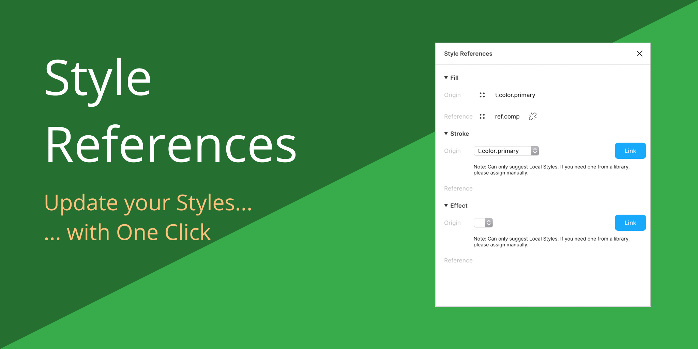

# Figma Plugin: Theemo

Theemo automates your design tokens by connecting your existing tools and make
them work together, from design to framework integration.

## Manual

The plugin UI has two tabs: **Styles** and **About**. The Styles section works
on top of Figma's local styles and variables:

- **Colors**: paint styles that are bound to a color variable can define
  transforms - Hue, Saturation, Lightness and Opacity - per mode. The
  transformed value is derived from the aliased origin and kept applied
  automatically.
- **Text & Effect**: styles can reference another local style. The reference
  is kept in sync whenever the origin style changes.

The configuration lives inside the document (a dedicated `.theemo/config` grid
style), so it travels with the file.

## Development

First, install the dependencies:

```bash
pnpm install
```

Build the plugin (one `vite build` produces both artifacts in `dist/`: the
Figma sandbox bundle and the single-file UI):

```bash
pnpm build
```

Or watch both build environments in a single process:

```bash
pnpm dev
```

Test, lint and format (plain `vite` / `vitest` / `oxlint` / `oxfmt`):

```bash
pnpm test        # Vitest: plugin (Figma API) + UI (bus contract & panels)
pnpm lint        # Oxlint (+ import boundaries via eslint-plugin-boundaries)
                 # + type checks: tsc for plugin/core, svelte-check for UI
pnpm fmt         # Oxfmt over the whole repo
```

Each check has an auto-fixing sibling: `pnpm lint:fix` and `pnpm fmt:fix`.

Import boundaries mirror the old package split: `src/plugin` and `src/ui`
must not import each other, both may import the shared `src/core` (which
takes no dependencies at all), and external packages are allowed per tree
as their former `package.json` did. See `oxlint.config.ts`
(`eslint-plugin-boundaries` rules).

Then point Figma to the `manifest.json` in this repository to load the plugin.

More documentation is available at [theemo.io](https://theemo.io).
